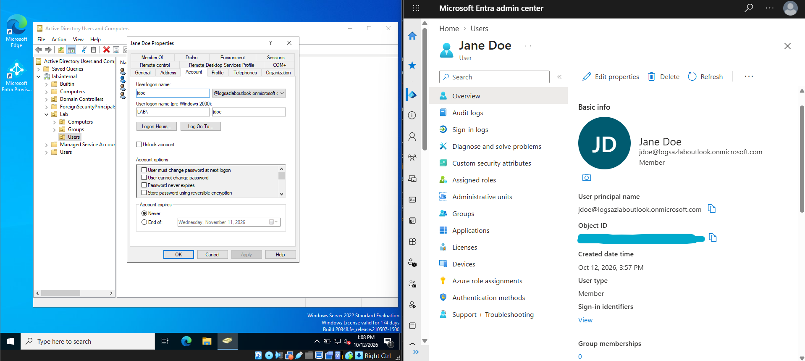
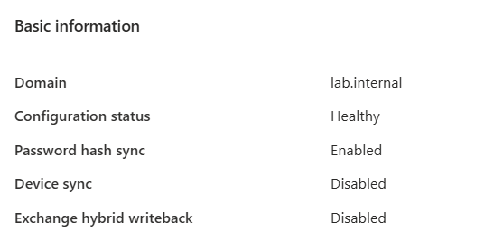
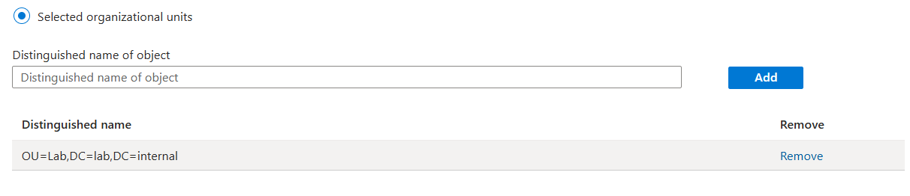
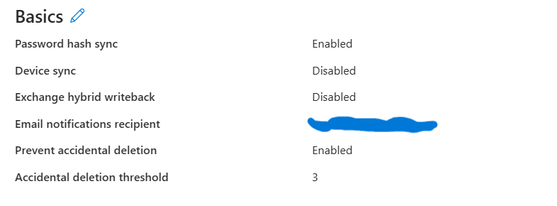

# P2: Sync to Entra ID

**Goal:** users created in on-prem AD appear in Entra ID and sign in with their on-prem password.

## What was built

1. **Checked the tenant**: primary domain is the `onmicrosoft.com` domain used as the P1 UPN suffix.
2. **Cloud-only `hiadmin`** with the Hybrid Identity Administrator role and MFA (Authenticator).
3. **Fixed DC name resolution** before installing anything. The agent needs outbound DNS,
   and the DC's own resolver was failing. See [troubleshooting](troubleshooting.md).
4. **KDS root key** so the agent can run as a gMSA.
5. **Cloud Sync provisioning agent** installed on DC01, showing Active in the portal.
6. **Sync configuration** for `lab.internal`: password hash sync on, scoped to `OU=Lab`
   (users and `GG-Lab-Readers`).



## Configuration





## Verify

- Entra ID → Users: the lab users show **On-premises sync enabled: Yes**
  ([screenshot](../screenshots/p2-sync/p2-07-source-windows-ad.png))
- Cloud sync → Provisioning logs: **Success** for each user
  ([screenshot](../screenshots/p2-sync/p2-06-provisioning-log.png))
- Signed in as `jdoe` with the **on-prem** password: password hash sync works
  ([screenshot](../screenshots/p2-sync/p2-09-test-signin.png))


On the DC:
```powershell
    Get-Service AADConnectProvisioningAgent      # Running (delayed start, give like 2 min)
    Get-ADServiceAccount -Filter "Name -like 'pGMSA_*'"  # the agent's gMSA
```
## Snapshots

`P1-f` → `P2-a` pre-agent (KDS key, DNS fixed) → `P2-b` first sync (protected, v1)
