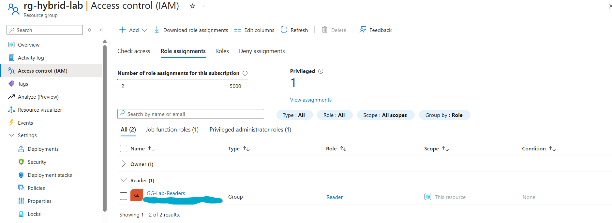
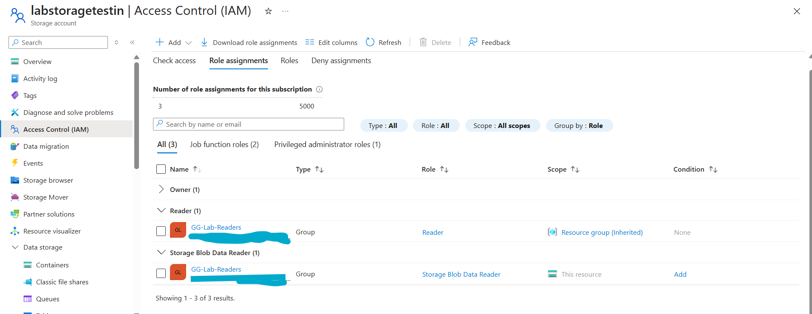

# P3: Azure Governance

**Goal:** a resource group with tags, a lock for deletion, group-based RBAC for the synced group,
and a tag policy, all at the resource-group scope.

## What was built

1. **Spending guardrails**: free-account spending limit on, plus a $5 monthly budget with alerts.
2. **`rg-hybrid-lab`** with tags `env=lab` and `project=hybrid-identity`.
3. **`CanNotDelete` lock** on the resource group. A delete attempt is refused.
4. **Reader for `GG-Lab-Readers`**, the group synced from on-prem AD. Access follows
   on-prem group membership.
5. **Azure Policy "Require a tag on resources"** (`env`), assigned to the resource group.
6. **Storage account + Storage Blob Data Reader** for the same group (data-plane access).

## Control plane vs data plane

The storage account shows both kinds of access for the same group:
- **Reader** inherited from the resource group (read the resource)
- **Storage Blob Data Reader** on the account itself (read the data)

## Verify

- Resource group tags ([screenshot](../screenshots/p3-governance/p3-02a-rg-tags.png))
  and lock ([screenshot](../screenshots/p3-governance/p3-02b-rg-lock.png))
- Policy compliance: 1 of 1 resources compliant
  ([screenshot](../screenshots/p3-governance/p3-04-policy-compliance.png))
- Budget ([screenshot](../screenshots/p3-governance/p3-01-cost-management.png))