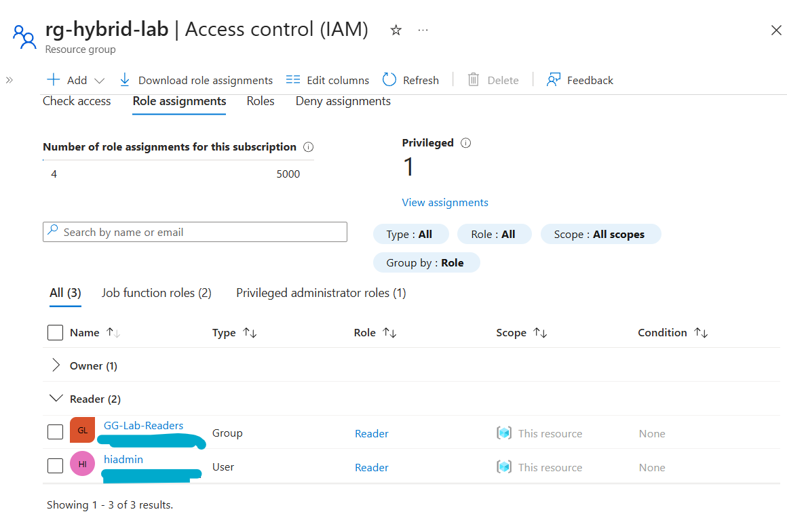
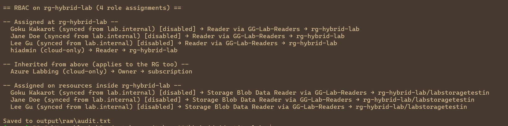
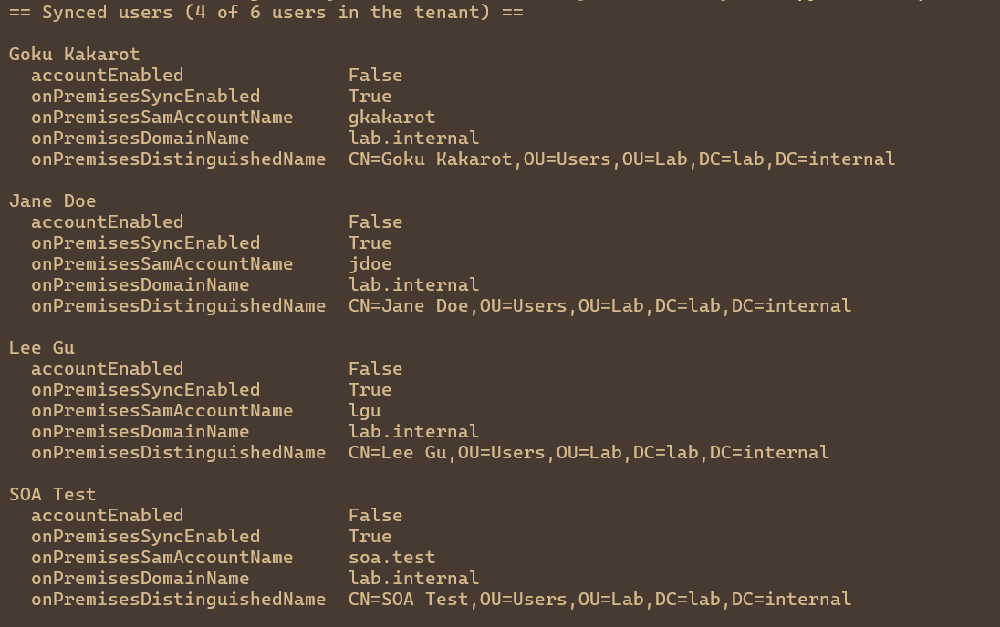

# P4: Python Audit

**Goal:** one report that shows who has access to `rg-hybrid-lab`, where each identity
comes from (synced from AD or cloud-only), and whether the access is direct or through a group.

## How it signs in

- **No app registration and no stored secret.** The script uses `AzureCliCredential`,
  which borrows the `az login` session.
- **Runs as `hiadmin` with Reader on `rg-hybrid-lab` only.** Directory reads use the default
  member rights in Entra. Resource reads use an Azure RBAC role. These are two separate
  permission systems.
- **The subscription ID comes from an environment variable**, so it's never in the code.



## What it does

1. **Synced users:** lists users from Microsoft Graph with `$select` for the `onPremises*`
   fields, and keeps the ones synced from `lab.internal`.
2. **Role assignments:** lists the assignments on the resource group from Azure Resource
   Manager, including inherited ones and ones on resources inside it.
3. **IDs to names:** resolves principals in one `getByIds` call, looks up role names
   (reading the role definition at resource-group scope, because Reader on the RG can't
   read it at subscription scope), and expands group members.
4. **Report:** groups the results by scope (at the RG, inherited, inside the RG).
   No object, tenant, or subscription IDs are printed.





Full run: [output/audit.txt](../output/audit.txt)

## Run it

```powershell
az login --tenant <tenant>.onmicrosoft.com
$env:AZURE_SUBSCRIPTION_ID = (az account show --query id -o tsv)
pip install -r requirements.txt
python scripts/audit_hybrid_identity.py --save output/raw/audit.txt
```

`output/raw/` is git-ignored. The committed `output/audit.txt` was reviewed before commit.

## Verify

- The report matches what P3 created. The 3 group members each appear for Reader on the RG
  and for Storage Blob Data Reader on the storage account, plus the hybrid admin's direct Reader
  and the inherited subscription Owner.
- No secret in the source ([screenshot](../screenshots/p4-python-audit/p4-04-source-in-editor.png)).
- The first run showed the group with no members. See [troubleshooting](troubleshooting.md).
