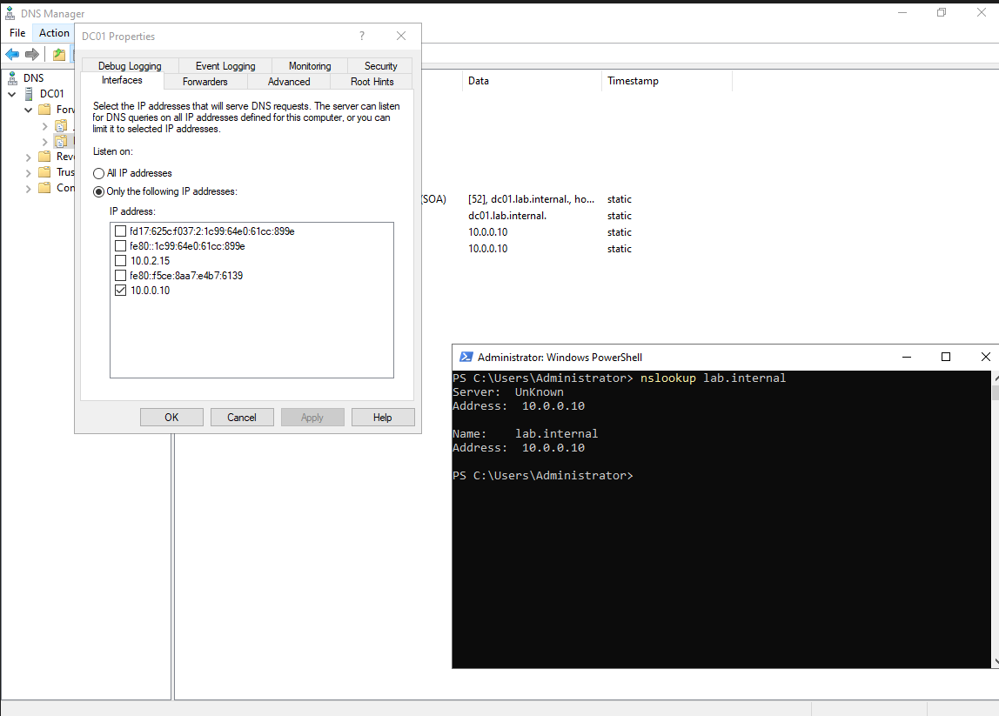
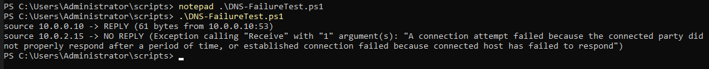
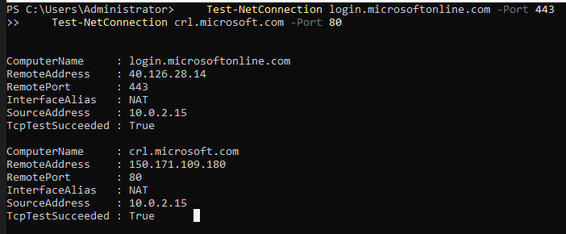

# Troubleshooting log

Problems hit while building the lab, newest at the bottom.

## 2026-10-06: DC kept publishing its NAT address in DNS

**Symptom:** `nslookup lab.internal` returned `10.0.2.15` alongside `10.0.0.10`.
`10.0.2.15` is DC01's VirtualBox NAT address.

**Fix (first pass):**
- Turned off *Register this connection's addresses in DNS* on the NAT adapter
- Stopped Netlogon from registering the extra records (`DnsAvoidRegisterRecords`)
- Deleted the stale records

**2026-10-07: it came back** after patching:
`dc01` had an A record for `10.0.2.15` and an AAAA record for the NAT adapter's IPv6 address.

**Root cause:** the DNS server was listening on every address on the machine.
A DNS server publishes host records for its own name using the addresses it listens on,
so every restart re-added the NAT addresses.

**Fix:** DNS server → Interfaces → listen on `10.0.0.10` only, then removed the stale records.

```powershell
$s = Get-DnsServerSetting -All
$s.ListeningIPAddress = @('10.0.0.10')
Set-DnsServerSetting -InputObject $s
```

**Verified after a reboot:** only `10.0.0.10` in the zone and in `nslookup`.



## 2026-10-07: script rerun failed with "name already in use"

**Symptom:** the second run of `New-LabUsers.ps1` stopped with
*an object with a name that is already in use*.

**Cause:** the skip check only matched `SamAccountName`. A user from the first run had
the same display name but a different sam, so the script tried to create it again,
and AD requires names to be unique within an OU.

**Fix:** check for both sam and name.

## 2026-10-08: VirtualBox running on the Windows hypervisor (turtle icon)

**Symptom:** green turtle in the VM status bar; DC tasks were very slow.
After researching, discovered it means VirtualBox cannot use VT-x directly
and is running on the Windows hypervisor.

**Ruled out:**
- Hyper-V, Virtual Machine Platform, Windows Hypervisor Platform, WSL: none enabled
- `bcdedit` `hypervisorlaunchtype Off` and `vsmlaunchtype off`: hypervisor still loaded
- `DeviceGuard\EnableVirtualizationBasedSecurity = 0`: VBS still running
- Memory Integrity (HVCI) and Credential Guard: both already off

**Root cause:** SkTool (Windows SDK) reported `VBS is enabled due to: VBS registry configuration`
with `VSM required` and `Key Guard: 1`. The only thing using VBS was Key Guard, which isolates
Windows Hello keys, and the only setting still on was `Scenarios\WindowsHello\Enabled = 1`.
Because VSM was required, the boot settings above were ignored.

**Fix:** backed up the DeviceGuard key, turned off the Hello scenario, rebooted, reset the Hello PIN.

```powershell
reg export HKLM\SYSTEM\CurrentControlSet\Control\DeviceGuard "$HOME\deviceguard-backup.reg"
Set-ItemProperty HKLM:\SYSTEM\CurrentControlSet\Control\DeviceGuard\Scenarios\WindowsHello -Name Enabled -Value 0
```

**Verified after a reboot:** `HypervisorPresent` False, scenario still `0`, dreaded turtle gone.

**Tradeoff:** Hello keys are still TPM-protected but no longer VBS-isolated. Temporary just for the lab.

## 2026-10-12: DC couldn't resolve names through its own resolver

**Symptom:** `Test-NetConnection login.microsoftonline.com -Port 443`
and `crl.microsoft.com -Port 80` both returned *Name resolution … failed*.
Clearing the DNS client cache changed nothing unfortunately.
([screenshot](../screenshots/p2-sync/p2-dns-01-resolution-failed.png))

**Ruled out:**
- Network: NAT had `10.0.2.15` and gateway `10.0.2.2`; a TCP test to `1.1.1.1:443` succeeded
- DNS: `Resolve-DnsName -Server 1.1.1.1` worked
- The DNS server: `-Server 10.0.0.10` answered a never-cached name in 0.07 s
- `::1` in the client's DNS server list was not present

What still failed: `Resolve-DnsName` with no `-Server` timed out, even for internal
records, while `nslookup` to the same server worked.

**Root cause:** the DNS Client operational log showed every query going to `10.0.0.10`
and getting no response ([screenshot](../screenshots/p2-sync/p2-dns-02-client-log.png)).
A small [test script](../scripts/Test-DnsSourceAddress.ps1) sent the same UDP query to `10.0.0.10` from each local address:
from `10.0.0.10` it got a reply, from `10.0.2.15` it got nothing.


Both adapters listed `10.0.0.10` as their DNS server, so the DNS Client sent the
NAT adapter's queries from `10.0.2.15`, and those never got an answer.



**Fix:**
- NAT adapter: static `10.0.2.15/24`, gateway `10.0.2.2`, no DNS servers. Static because
  DHCP would push VirtualBox's `10.0.2.3`, which doesn't know the lab's internal domain.
- That exposed VirtualBox's IPv6 DNS proxy (`fd17:…::3`) on the NAT adapter,
  so IPv6 was unbound from NAT too.

**Verified after reboot:** both checks pass with source `10.0.2.15`, the SRV lookup
answers through the resolver, and the zone still holds only `10.0.0.10` with no AAAA records.



## 2026-10-19: Synced group shows no members in Entra

**Symptom:** The P4 audit listed `GG-Lab-Readers` with `(no members)` on both role
assignments. In AD, the group has 3 members.

**Ruled out:**
- The script: `az ad group member list --group GG-Lab-Readers` (same CLI sign-in) also
  returned nothing.
- Disabled accounts: disabled users keep their group memberships, and the members'
  disabled state had synced to Entra normally on Oct 12.

**Cause:** The Cloud Sync configuration for `lab.internal` was quarantined. The DC was
off between phases, so the agent couldn't reach the domain, and the job stopped exporting.

**Fix:** Started the DC, confirmed the agent was active, and used **Restart provisioning**
on the configuration (no reset). Provision on demand for `jdoe` confirmed the agent could
read the domain again.

**Verified:** After the next sync cycle, `az ad group member list` and the audit both
show 3 members.
