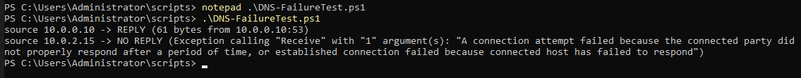
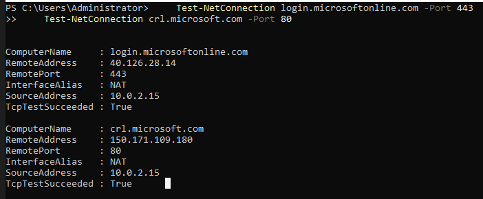

# Troubleshooting log

Problems hit while building the lab, newest at the bottom.

## 2026-10-06: DC kept publishing its NAT address in DNS

**Issue:** `nslookup lab.internal` returned `10.0.2.15` alongside `10.0.0.10`.
`10.0.2.15` is DC01's VirtualBox NAT address according to docs.

**Fix:** DNS server → Interfaces → listen on `10.0.0.10` only, then removed the stale records.

```powershell
$s = Get-DnsServerSetting -All
$s.ListeningIPAddress = @('10.0.0.10')
Set-DnsServerSetting -InputObject $s
```


## 2026-10-07: script rerun failed with "name already in use"

**Issue:** the second run of `New-LabUsers.ps1` stopped with
*an object with a name that is already in use*.

**Fix:** check for both sam and name. AD wants names to be unique, and the second run tried to create a user
with the same display name but a different sam.

## 2026-10-08: VirtualBox running on the Windows hypervisor (turtle icon)

**Issue:** green turtle in the VM status bar; DC tasks were very slow.
After researching, discovered it means VirtualBox cannot use VT-x directly
and is running on the Windows hypervisor.

**Cause:** Windows SDK reported `VBS is enabled due to: VBS registry configuration`. Key Guard was still enabled through the Windows Hello scenario.

**Fix:** backed up my DeviceGuard key, turned off the Hello scenario, rebooted, reset the Hello PIN.

## 2026-10-12: DC couldn't resolve names through its own resolver

**Issue:** `Test-NetConnection login.microsoftonline.com -Port 443`
and `crl.microsoft.com -Port 80` both returned *Name resolution … failed*.
Clearing the DNS client cache changed nothing unfortunately.
([screenshot](../screenshots/p2-sync/p2-dns-01-resolution-failed.png))

**Cause:** the DNS Client operational log showed every query going to `10.0.0.10`
and getting no response ([screenshot](../screenshots/p2-sync/p2-dns-02-client-log.png)).



**Fix:**
- NAT adapter: static `10.0.2.15/24`, gateway `10.0.2.2`, no DNS servers. Static because
  DHCP would push VirtualBox's `10.0.2.3`, which doesn't know the lab's internal domain.



## 2026-10-19: Synced group shows no members in Entra

**Issue:** P4 phase listed `GG-Lab-Readers` with `(no members)` on both role
assignments. In AD, the group has 3 members.

**Cause:** The Cloud Sync configuration for `lab.internal` was quarantined. The DC was
off between phases, so the agent couldn't reach the domain, and the job stopped exporting.

**Fix:** Started the DC, confirmed the agent was active, and used **Restart provisioning**
on the configuration. Provision on demand for `jdoe` confirmed the agent could
read the domain again.
