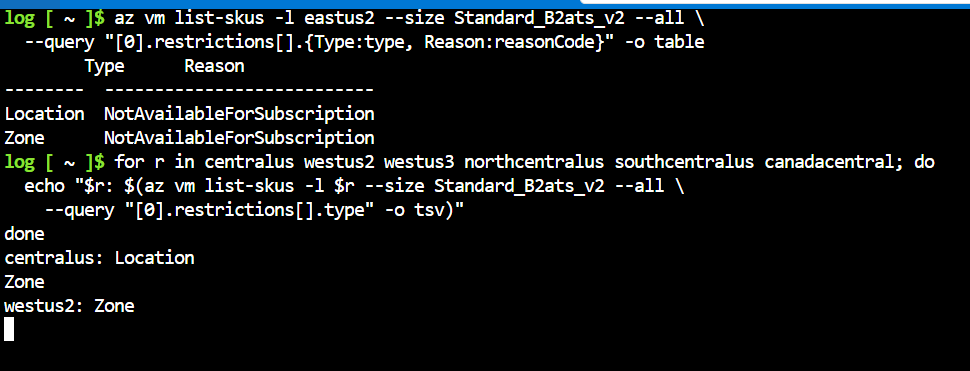

## 2026-10-24: VM sizes not available for this subscription

**Symptom:** `az vm create` failed with `SkuNotAvailable` in `eastus` for
`Standard_B1s`, `Standard_B2ats_v2`, `Standard_B1ms` and `Standard_B2als_v2`.
The CLI crashed while formatting the error, so the real message was buried
in a traceback under `Exception Details`.

**Ruled out:**
- VM size: four B-series sizes failed the same way
- Quota: the error code was `SkuNotAvailable`, not a quota error

**Cause:** subscription-level restriction.
`az vm list-skus --all` showed every B-series size as `NotAvailableForSubscription`
in `eastus2`. `Standard_B2ats_v2` had a `Location` restriction in `eastus2` and
`centralus`, and only a `Zone` restriction in `westus2`.

**Fix:** re-created the NSGs and VNets in `westus2` with `-l $LOC`, and created
the VMs without `--zone`. The resource group stays in `eastus`; its location
does not limit where its resources go.

**Verified:** both VMs created in `westus2` (`10.10.1.4` and `10.20.1.4`).

