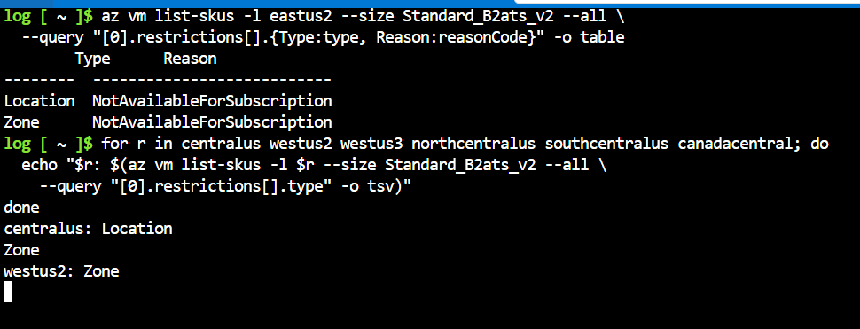

## 2026-10-24: VM sizes not available for this subscription

**Symptom:** `az vm create` failed with `SkuNotAvailable` in `eastus` for multiple SKUs.
The CLI crashed while formatting the error, so the real message was buried
in a traceback.

**Things I tried:**
- VM size: four B-series sizes failed the same way
- Quota: error code was `SkuNotAvailable`

**Cause:** subscription-level restriction.
`az vm list-skus --all` showed every B-series size as `NotAvailableForSubscription`
in `eastus2`. `Standard_B2ats_v2` had a `Location` restriction in `eastus2` and
`centralus`, and only a `Zone` restriction in `westus2`.

**How I fixed it:** re-created the NSGs and VNets in `westus2`, and created
the VMs without `--zone`. The resource group stays in `eastus`, as it doesn't
limit where the resources can deploy.

**Checked:** both VMs created in `westus2` (`10.10.1.4` and `10.20.1.4`).

